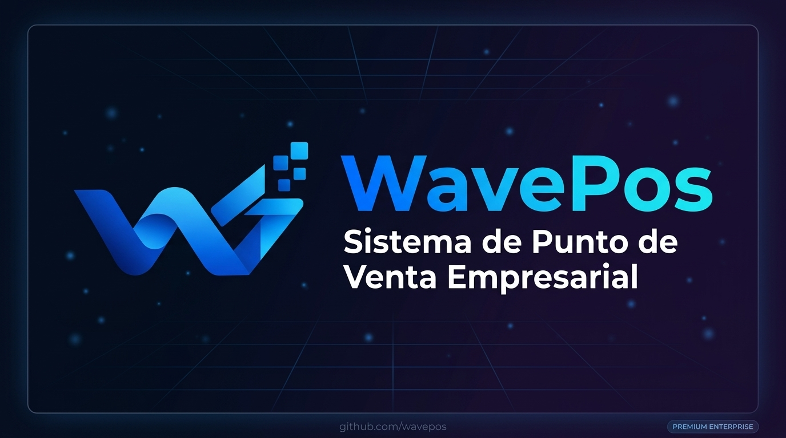

<div align="center">



<br/>

[](https://laravel.com)
[](https://www.php.net)
[](https://livewire.laravel.com)
[](https://tailwindcss.com)
[](https://mysql.com)
[](https://vercel.com)

<br/>

**WavePos** es un sistema de punto de venta empresarial moderno, construido sobre **Laravel 12** con arquitectura robusta y escalable.
Diseñado para negocios que necesitan control total sobre ventas, inventario, finanzas, compras y más — todo en una sola plataforma.

<br/>

[]()
[]()
[]()

</div>

---

## 📋 Tabla de Contenidos

- [Caracteristicas Principales](#-caracteristicas-principales)
- [Modulos del Sistema](#-modulos-del-sistema)
- [Stack Tecnologico](#-stack-tecnologico)
- [Arquitectura](#-arquitectura)
- [Estado de Avance](#-estado-de-avance)
- [Instalacion](#-instalacion)
- [Despliegue en Vercel](#-despliegue-en-vercel)
- [Estructura del Proyecto](#-estructura-del-proyecto)

---

## 🚀 Características Principales

| Rendimiento | Seguridad | Integraciones | Responsive |
|:---:|:---:|:---:|:---:|
| Vite + Alpine.js | Roles y Permisos Spatie | WooCommerce API REST | Todos los dispositivos |

- **Multi-sucursal** - Gestion centralizada de multiples puntos de venta
- **Control de Roles** - Sistema de permisos granular por usuario
- **Factura Electronica** - Integracion con Factus para emision electronica
- **Integracion WooCommerce** - Sincronizacion bidireccional con tiendas en linea
- **Dashboard Analitico** - Metricas en tiempo real con ApexCharts
- **Exportacion PDF/Excel** - Reportes y documentos profesionales
- **Alertas Inteligentes** - Notificaciones de stock bajo y vencimientos
- **Calendario de Pagos** - Recordatorios con FullCalendar.js

---

## 📦 Módulos del Sistema

### 🟢 Módulos Completados

#### 1. 🔐 Autenticación & Seguridad
Control de acceso completo con roles y permisos empresariales.

- Login / Logout seguro con sesiones en base de datos
- Sistema de roles (Admin, Vendedor, Bodeguero, etc.)
- Politicas de acceso por modulo (Policies)
- Gestion de usuarios y contrasenas

#### 2. 📊 Dashboard & Analytics
Panel de control ejecutivo con metricas en tiempo real.

- KPIs de ventas diarias, semanales y mensuales
- Graficos interactivos con ApexCharts
- Top productos mas vendidos
- Alertas de stock bajo
- Resumen de caja y movimientos del dia

#### 3. 🛍️ Punto de Venta (POS)
Interfaz optimizada para velocidad en el mostrador.

- Busqueda rapida de productos por nombre/codigo/barras
- Aplicacion de descuentos por linea o total
- Multiples metodos de pago (efectivo, tarjeta, transferencia)
- Soporte para ventas en espera (hold orders)
- Impresion de recibos y tickets
- Devoluciones y anulaciones

#### 4. 📦 Inventario
Control completo del ciclo de vida del inventario.

- Gestion de productos con variantes
- Categorias y subcategorias jerarquicas
- Control de stock con alertas automaticas
- Registro de movimientos de inventario (entradas, salidas, ajustes)
- Gestion de proveedores
- Generacion de codigos de barras

#### 5. 🛒 Compras
Ciclo completo de abastecimiento y pagos a proveedores.

- Ordenes de compra con detalle de productos
- Recepcion parcial o total de mercancia
- Pagos a proveedores con multiples cuotas
- Historial completo de compras por proveedor

#### 6. 💰 Caja
Control del flujo de efectivo en el punto de venta.

- Apertura y cierre de caja por turno
- Registro de entradas y salidas manuales
- Arqueo de caja con diferencias
- Historial de movimientos por sesion

#### 7. 👤 Clientes
CRM basico para gestion de cartera de clientes.

- Registro completo de clientes (datos fiscales, contacto)
- Historial de compras por cliente
- Saldo pendiente y credito disponible
- Exportacion de listado en Excel

#### 8. 💳 Cuentas por Cobrar
Gestion de credito a clientes.

- Ventas a credito con plazos configurables
- Registro de abonos parciales
- Alertas de vencimiento de cuotas
- Estado de cuenta por cliente

#### 9. 💸 Cuentas por Pagar
Control de obligaciones financieras con proveedores.

- Registro de deudas por compras
- Programacion de pagos
- Historial de abonos y saldos pendientes
- Calendario de pagos con FullCalendar.js

#### 10. 📉 Gastos
Registro y control de egresos operativos.

- Categorias de gastos personalizables
- Registro con comprobantes (fecha, monto, proveedor)
- Reportes de gastos por periodo y categoria
- Integracion con modulo de finanzas

#### 11. 📈 Finanzas
Vista consolidada de la salud financiera del negocio.

- Estado de resultados (ingresos vs gastos)
- Flujo de caja del periodo
- Reportes exportables en PDF y Excel
- Recordatorios financieros con calendario

#### 12. 🧾 Facturación Electrónica
Emision de facturas electronicas conforme a normativa fiscal.

- Integracion con Factus API para emision electronica
- Generacion de CUFE y QR fiscal
- Descarga de PDF oficial de la factura
- Anulacion y notas credito
- Listado con estado: Pendiente / Emitida / Anulada

#### 13. 🛒 Integración WooCommerce
Sincronizacion bidireccional con tienda en linea WordPress.

- Importacion de productos desde WooCommerce
- Sincronizacion de stock en tiempo real via Webhooks
- Creacion de pedidos en WavePos desde WooCommerce
- Sincronizacion de clientes
- Panel de gestion de la integracion

#### 14. ⚙️ Configuración
Panel de administracion y personalizacion del sistema.

- Datos de la empresa (logo, informacion fiscal)
- Gestion de sucursales
- Parametros del sistema
- Gestion de usuarios y roles

---

## 🛠️ Stack Tecnológico

### Backend

| Tecnologia | Version | Uso |
|---|---|---|
| **PHP** | ^8.2 | Lenguaje base del servidor |
| **Laravel** | ^12.0 | Framework MVC principal |
| **Livewire** | ^4.2 | Componentes reactivos full-stack |
| **Livewire Flux** | ^2.13 | Componentes UI premium |
| **MySQL** | 8.x | Base de datos principal |
| **Spatie Permission** | ^6.24 | Roles y permisos |
| **Maatwebsite Excel** | ^3.1 | Exportacion/Importacion Excel |
| **Laravel DomPDF** | ^3.1 | Generacion de PDFs |
| **Spatie Laravel PDF** | ^2.4 | PDFs avanzados con Puppeteer |
| **Milon Barcode** | ^13.1 | Generacion de codigos de barras |
| **SweetAlert** | ^7.3 | Alertas y confirmaciones UI |

### Frontend

| Tecnologia | Version | Uso |
|---|---|---|
| **Vite** | ^7.0 | Bundler y dev server |
| **TailwindCSS** | ^4.1 | Framework CSS utility-first |
| **Alpine.js** | ^3.14 | Interactividad JavaScript ligera |
| **FlyonUI** | ^2.4 | Componentes UI sobre Tailwind |
| **ApexCharts** | ^5.3 | Graficos interactivos |
| **FullCalendar** | ^6.1 | Calendario interactivo |
| **Swiper.js** | ^12.0 | Carruseles y sliders |
| **Flatpickr** | ^4.6 | Selectores de fecha |
| **Notiflix** | ^3.2 | Notificaciones toast |
| **Iconify (Tabler)** | ^1.2 | Libreria de iconos |
| **Puppeteer** | ^24.39 | Renderizado headless para PDFs |

### Integraciones y Servicios

| Servicio | Proposito |
|---|---|
| **Factus API** | Facturacion electronica fiscal |
| **WooCommerce REST API** | Sincronizacion con e-commerce |
| **Supabase** | Base de datos en la nube |
| **Vercel** | Plataforma de despliegue |

---

## 🏗️ Arquitectura

```
WavePos/
+-- app/
|   +-- Console/          # Comandos Artisan personalizados
|   +-- Exports/          # Exportadores Excel (Maatwebsite)
|   +-- Helpers/          # Funciones helper globales
|   +-- Http/
|   |   +-- Controllers/  # 25 controladores de dominio
|   +-- Imports/          # Importadores de datos
|   +-- Models/           # 24 modelos Eloquent
|   +-- Policies/         # Politicas de autorizacion
|   +-- Providers/        # Service Providers
|   +-- Services/         # Capa de servicios
|       +-- FactusService.php       # Facturacion electronica
|       +-- VentaService.php        # Logica de ventas
|       +-- WooCommerceService.php  # Integracion WooCommerce
+-- resources/
|   +-- views/
|       +-- pages/
|           +-- auth/         # Autenticacion
|           +-- caja/         # Control de caja
|           +-- clientes/     # Gestion de clientes
|           +-- compras/      # Modulo de compras
|           +-- configuracion/ # Configuracion
|           +-- cuentas/      # Cuentas por cobrar/pagar
|           +-- dashboard/    # Panel de control
|           +-- facturacion/  # Factura electronica
|           +-- finanzas/     # Modulo financiero
|           +-- gastos/       # Control de gastos
|           +-- inventario/   # Gestion de inventario
|           +-- woocommerce/  # Integracion WooCommerce
+-- database/
|   +-- migrations/       # Migraciones de base de datos
|   +-- seeders/          # Datos iniciales
+-- routes/
    +-- web.php           # 388 lineas de rutas definidas
```

---

## 📊 Estado de Avance

### Progreso General del Proyecto

```
████████████████████░░░░  80% Completado
```

### Modulos por Estado

| Modulo | Estado | Progreso |
|---|---|---|
| 🔐 Autenticación & Roles | ✅ Completo | █████████████████████ 100% |
| 📊 Dashboard | ✅ Completo | █████████████████████ 100% |
| 🛍️ Punto de Venta (POS) | ✅ Completo | █████████████████████ 100% |
| 📦 Inventario | ✅ Completo | █████████████████████ 100% |
| 🛒 Compras | ✅ Completo | █████████████████████ 100% |
| 💰 Caja | ✅ Completo | █████████████████████ 100% |
| 👤 Clientes | ✅ Completo | █████████████████████ 100% |
| 💳 Cuentas por Cobrar | ✅ Completo | ████████████████████░ 95% |
| 💸 Cuentas por Pagar | ✅ Completo | ████████████████████░ 95% |
| 📉 Gastos | ✅ Completo | █████████████████████ 100% |
| 📈 Finanzas | 🔄 En Progreso | ████████████████░░░░░ 75% |
| 🧾 Facturación Electrónica | 🔄 En Progreso | ████████████████░░░░░ 75% |
| 🛒 WooCommerce | 🔄 En Progreso | ██████████████░░░░░░░ 70% |
| ⚙️ Configuración | 🔄 En Progreso | ████████████████░░░░░ 80% |
| 🌐 Landing Page SaaS | 🔄 En Progreso | ████████████░░░░░░░░░ 60% |
| 🧪 Tests Automatizados | ⏳ Pendiente | ████░░░░░░░░░░░░░░░░░ 20% |

---

## ⚙️ Instalación

### Requisitos Previos

- PHP >= 8.2
- Composer >= 2.x
- Node.js >= 20.x
- MySQL >= 8.0

### 1. Clonar el Repositorio

```bash
git clone https://github.com/tu-usuario/wavepos.git
cd wavepos
```

### 2. Instalar Dependencias

```bash
composer install
npm install
```

### 3. Configurar el Entorno

```bash
cp .env.example .env
php artisan key:generate
```

Editar el archivo `.env` con tus credenciales de base de datos.

### 4. Migrar la Base de Datos

```bash
php artisan migrate --seed
```

### 5. Iniciar el Servidor de Desarrollo

```bash
composer run dev
```

La aplicacion estara disponible en `http://127.0.0.1:8000`

---

## 🌐 Despliegue en Vercel

WavePos incluye configuracion lista para despliegue en **Vercel**.

```bash
npm i -g vercel
vercel --prod
```

Consulta el archivo [DEPLOY_VERCEL.md](DEPLOY_VERCEL.md) para la guia completa de despliegue.

---

## 📁 Estructura del Proyecto

| Directorio | Descripcion |
|---|---|
| app/Http/Controllers/ | 25 controladores organizados por dominio |
| app/Models/ | 24 modelos Eloquent con relaciones |
| app/Services/ | Servicios: Factus, Ventas, WooCommerce |
| resources/views/pages/ | 12 modulos de vistas Blade |
| resources/views/components/ | Componentes reutilizables de UI |
| database/migrations/ | Esquema completo de base de datos |
| routes/web.php | Todas las rutas de la aplicacion |
| public/website/ | Landing page publica (SaaS) |

---

<div align="center">

---

**WavePos** © 2026 · Todos los derechos reservados

Construido con ❤️ usando **Laravel** + **Livewire** + **TailwindCSS**

[](https://laravel.com)

</div>
